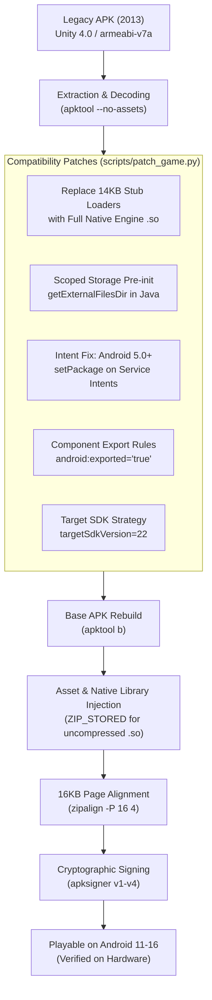

# Tons of Guns - Modern Android Porting & Historical Preservation Pipeline

[](https://developer.android.com)
[](https://developer.android.com/guide/practices/page-sizes)
[](https://unity.com)
[](#disclaimers-and-notices)

An open-source research toolchain and automated pipeline that allows users to port the 2013 mobile game *Tons of Guns* to be able to play on latest Android versions (including Android 11 through Android 16) for historical game preservation.

---

## Disclaimers and Notices

> [!IMPORTANT]
> **Educational and Historical Preservation Scope**
> This repository is maintained strictly for archival, educational, interoperability, and software preservation purposes under fair use doctrine. Its objective is to research compatibility layers, bytecode patching, and native library alignment techniques required to sustain early 32-bit mobile gaming history on modern operating systems.

> [!WARNING]
> **No Copyrighted Files Notice**
> This repository **does not contain any copyrighted game binaries, proprietary engine binaries, 3D models, textures, art, animations, or audio assets**. 
> 
> Users must supply their own legally acquired copy of the original APK file (`tog_orig.apk`). The scripts in this repository act solely as an in-place patcher, reconstruction tool, and packager.

> [!NOTE]
> **Non-Affiliation Disclaimer**
> This repository is an independent, community-driven preservation project. It is **not affiliated with, authorized by, sponsored by, endorsed by, or in any way connected to the original game developers, publishers, or any of their subsidiaries or affiliates**.

> [!NOTE]
> **Trademark Attribution**
> All product names, logos, brands, trademarks, and registered trademarks—including *Tons of Guns*, *Unity*, and *Android*—are the property of their respective owners. Their use within this repository is strictly for nominative identification, technical documentation, and interoperability reference.

---

## Technical Architecture & Compatibility Challenges

Running a 2013 Unity 4.0 title on modern Android versions (Android 11 through Android 16) presents multiple architectural barriers across the native linker, Android runtime (ART), and file system security layers:



### 1. The Stub Loader Architecture
In 2013, early Unity games avoided packaging large native binaries directly into `lib/armeabi-v7a/`. Instead, they installed 14KB stub loaders that attempted to unpack the real ~9MB `libunity.so` and `libmono.so` from `assets/libs/` into private internal storage at runtime.
* **Modern Failure**: Modern Android enforces strict W^X (Write XOR Execute) memory protections and forbids executing dynamic libraries from writable app data directories.
* **Resolution**: The pipeline extracts the full engine binaries from `assets/libs/armeabi-v7a/` and installs them directly into `apk_decoded/lib/armeabi-v7a/`, completely removing the obsolete unpacker.

### 2. Scoped Storage & POSIX `mkdir` Restrictions (Android 11+)
In Android 11+ (API 30+), applications are confined to Scoped Storage. Native C/C++ calls (like `mkdir` inside Unity's POSIX file subsystem) to `/storage/emulated/0/Android/data/<package>/` fail immediately with:
```
UnauthorizedAccessException: Access to the path "/storage/emulated/0/Android/data/com.package.game" is denied.
```
* **Resolution**: In `UnityLauncherActivity.smali`'s `onCreate()` bootstrap method, we inject a bytecode call to `Context.getExternalFilesDir(null)`. This invokes the Android OS framework (`vold` daemon), ensuring the application-specific external folder is created with proper UID ownership before the native Unity engine initializes. In addition, `UnityUnpacker.cachePath` is patched to return `context.getExternalFilesDir(null)`.

### 3. Android 5.0+ Implicit Service Intent Restrictions
Beginning in Android 5.0 (API 21), Android's `Context.bindService()` enforces that all service intents must be explicit. Calling `bindService` with an implicit intent triggers:
```
java.lang.IllegalArgumentException: Service Intent must be explicit: Intent { act=com.google.android.gms.games.service.START }
```
* **Resolution**: Bytecode patches in `q.smali`, `GoogleIAP.smali`, `GoogleIAP$1.smali`, `AnalyticsGmsCoreClient.smali`, and `LicenseChecker.smali` inject `invoke-virtual {vX, vY}, Landroid/content/Intent;->setPackage(Ljava/lang/String;)Landroid/content/Intent;` before service binding, targeting `"com.google.android.gms"` or `"com.android.vending"`.

### 4. Android 15 & 16 16KB Page Alignment
Android 15 and 16 require that native shared libraries in 16KB-page kernel environments are aligned to 16KB boundaries within the ZIP archive:
* **Resolution**: Uncompressed storage (`ZIP_STORED`) for all `.so` files and `resources.arsc`, paired with `android:extractNativeLibs="true"` in `AndroidManifest.xml`, aligned via:
  ```bash
  zipalign -f -P 16 4 unaligned.apk aligned.apk
  ```

### 5. Target SDK & Text Relocations
Unity 4's 32-bit ARM shared libraries contain non-PIC (Position-Independent Code) text relocations. Android 6.0+ (API 23+) dynamic linkers reject binaries with text relocations when `targetSdkVersion >= 23`.
* **Resolution**: Setting `targetSdkVersion="22"` retains backward compatibility with the legacy dynamic linker while `minSdkVersion="21"` enables installation on 64/32-bit hybrid modern Android devices.

---

## Repository Structure

```
├── .gitignore               # Ignores all binaries, decompiled assets, and tools
├── README.md                # Project documentation and legal disclaimers
└── scripts/
    ├── build_all.py         # End-to-end automated porting and packaging pipeline
    ├── patch_game.py        # Smali bytecode and AndroidManifest compatibility patcher
    ├── package_and_sign.py  # Standalone 16KB alignment and apksigner utility
    ├── set_target_22.py     # Utility to adjust apktool targetSdkVersion
    └── update_manifest.py   # Standalone manifest transformation utility
```

---

## Prerequisites

1. **Python 3.8+**
2. **Java Development Kit (JDK 17+)** (`java` and `keytool` in PATH)
3. **Android SDK Build-Tools (v34+)**:
   - `zipalign`
   - `apksigner`
   - `adb` (platform-tools)
4. **Decompilation & Packaging Tools** (placed into `tools/` if running from scratch):
   - [Apktool](https://apktool.org/) (`tools/apktool/apktool.jar`)
   - [Jadx](https://github.com/skylot/jadx) (`tools/jadx/`)
   - [.NET 8+ and ILSpy.Cmd](https://github.com/icsharpcode/ILSpy) (optional, for C# decompilation)

---

## Step-by-Step Usage Guide

### 1. Supply Your Legitimate Game APK
Place your original, legally owned game APK into the project root named `tog_orig.apk`:
```bash
cp /path/to/original_game.apk ./tog_orig.apk
```
*(The build script will also auto-detect any original `.apk` placed in the workspace).*

### 2. Run the Automated Build Pipeline
Execute the master build script:
```bash
python scripts/build_all.py
```

To also decompile the game's C# scripts (Assembly-CSharp) and Java sources into readable code:
```bash
python scripts/build_all.py --decompile
```

To specify custom input or output paths:
```bash
python scripts/build_all.py --input path/to/source.apk --output path/to/output.apk
```

### 3. Deploy and Run via ADB
To install the ported APK to a connected device:
```bash
adb install --no-incremental -r tog_ported.apk
```

Launch the game activity directly:
```bash
adb shell am start -n com.package.game/.UnityLauncherActivity
```

---

## Compatibility & Feature Status Checklist

The unified checklist below details all game, platform, and engine features—indicating what is currently operational (`[x]`) versus current architectural limitations (`[ ]`):

- [x] **Automated Build & Porting Pipeline**: Full APK decoding, Smali bytecode patching, 16KB alignment, and multi-scheme signing
- [x] **Modern Android OS Installation**: Installs cleanly on Android 11 through Android 16 Preview without package manager conflicts
- [x] **16KB Page Alignment**: ELF shared libraries aligned to 16KB boundaries (`zipalign -P 16 4`) for modern Linux kernels
- [x] **Scoped Storage Pre-initialization**: Pre-creates application files directory via `getExternalFilesDir(null)` to eliminate `UnauthorizedAccessException`
- [x] **Direct Launcher Bypass**: Routes launch intent directly to the game activity, bypassing defunct expansion download screens
- [x] **Legacy Dynamic Linker Relocations**: Target SDK configured to retain runtime support for legacy 32-bit text relocations
- [x] **3D Engine & Graphics Rendering**: Full OpenGL ES 2.0 rendering (weapons, crosshair, enemies, and environments)
- [x] **Touch & Motion Controls**: Touch-based firing/reloading, weapon switching, and accelerometer/gyroscope tilt aiming
- [x] **Local Audio Playback**: FMOD sound engine playing background music tracks and weapon sound effects
- [x] **Single-Player Gameplay Loop**: Level 1 mission loading, combat logic, and shootout progression
- [x] **Weapon Systems**: Local weapon inventory, firing animations, hit detection, and ammo counts
- [x] **32-bit ARM (ARMv7-A) Execution**: Runs on devices with 32-bit silicon support or hybrid 32/64-bit Android OS builds
- [ ] **Native 64-bit-Only Architecture Support**:
  > **What is Native 64-bit Only?**  
  > The original 2013 game binaries (`libunity.so`, `libmono.so`) were compiled exclusively for 32-bit ARM (`armeabi-v7a`). Newer devices (such as Google Pixel 7/8/9 and devices with Snapdragon 8 Gen 3 or Tensor G2+) feature 64-bit-only CPUs that have physically dropped 32-bit instruction execution in hardware. On such devices, running this 32-bit game requires an operating system binary translation layer (e.g., Houdini, Bertha, or a 32-bit container/emulator). True native 64-bit execution without a translator cannot be achieved without the original proprietary C++ engine source code.

---

## Unsupported & Impossible Features (Dead Servers & Out of Scope)

The following features relied on remote cloud infrastructure and third-party web backends that were permanently decommissioned over a decade ago. **These features will NOT be implemented or fixed in this repository**:

* **Real-Money In-App Purchases (IAP)**:  
  *Why it is impossible*: Google Play In-App Billing v3 and publisher payment verification servers are permanently dead. Purchases cannot be processed or validated.
* **Online Multiplayer & Matchmaking**:  
  *Why it is impossible*: The third-party game servers and matchmaking lobbies were permanently shut down.
* **Google Play Games Cloud Saves**:  
  *Why it is impossible*: Legacy Google Play Games cloud synchronization endpoints no longer exist.
* **Global Leaderboards & Social Systems**:  
  *Why it is impossible*: Third-party leaderboards and social feed servers are offline.
* **Remote Asset Expansion CDN Downloads**:  
  *Why it is impossible*: The original Amazon S3 cloud buckets that delivered expansion assets in 2013 are long gone. All necessary assets are packed locally inside the reconstructed APK.
* **Push Notifications & Analytics**:  
  *Why it is impossible*: Legacy Google Cloud Messaging (GCM) and Flurry analytics endpoints have been decommissioned for years.

---

## Contributing & Development

Contributions to improve compatibility with upcoming Android releases (such as future 64-bit-only translaters like `houdini` or `bertha`) are welcome. Please ensure that all contributions adhere to the project's non-infringement policies and contain no proprietary game assets.
