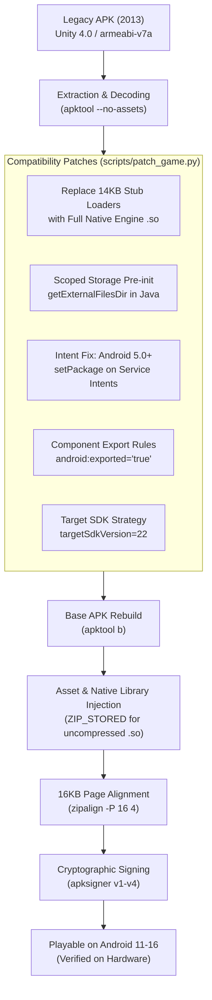

# Tons of Guns - Modern Android Porting & Historical Preservation Pipeline

[](https://developer.android.com)
[](https://developer.android.com/guide/practices/page-sizes)
[](https://unity.com)
[](#disclaimers-and-notices)

An open-source research toolchain and automated pipeline that allows users to port the 2013 mobile game *Tons of Guns* to be able to play on latest Android versions (including Android 11 through Android 16) for historical game preservation.

---

## Disclaimers and Notices

> [!IMPORTANT]
> **Educational and Historical Preservation Scope**
> This repository is maintained strictly for archival, educational, interoperability, and software preservation purposes under fair use doctrine. Its objective is to research compatibility layers, bytecode patching, and native library alignment techniques required to sustain early 32-bit mobile gaming history on modern operating systems.

> [!WARNING]
> **No Copyrighted Files Notice**
> This repository **does not contain any copyrighted game binaries, proprietary engine binaries, 3D models, textures, art, animations, or audio assets**. 
> 
> Users must supply their own legally acquired copy of the original APK file (`tog_orig.apk`). The scripts in this repository act solely as an in-place patcher, reconstruction tool, and packager.

> [!NOTE]
> **Non-Affiliation Disclaimer**
> This repository is an independent, community-driven preservation project. It is **not affiliated with, authorized by, sponsored by, endorsed by, or in any way connected to the original game developers, publishers, or any of their subsidiaries or affiliates**.

> [!NOTE]
> **Trademark Attribution**
> All product names, logos, brands, trademarks, and registered trademarks—including *Tons of Guns*, *Unity*, and *Android*—are the property of their respective owners. Their use within this repository is strictly for nominative identification, technical documentation, and interoperability reference.

---

## Technical Architecture & Compatibility Challenges

Running a 2013 Unity 4.0 title on modern Android versions (Android 11 through Android 16) presents multiple architectural barriers across the native linker, Android runtime (ART), and file system security layers:



### 1. The Stub Loader Architecture
In 2013, early Unity games avoided packaging large native binaries directly into `lib/armeabi-v7a/`. Instead, they installed 14KB stub loaders that attempted to unpack the real ~9MB `libunity.so` and `libmono.so` from `assets/libs/` into private internal storage at runtime.
* **Modern Failure**: Modern Android enforces strict W^X (Write XOR Execute) memory protections and forbids executing dynamic libraries from writable app data directories.
* **Resolution**: The pipeline extracts the full engine binaries from `assets/libs/armeabi-v7a/` and installs them directly into `apk_decoded/lib/armeabi-v7a/`, completely removing the obsolete unpacker.

### 2. Scoped Storage & POSIX `mkdir` Restrictions (Android 11+)
In Android 11+ (API 30+), applications are confined to Scoped Storage. Native C/C++ calls (like `mkdir` inside Unity's POSIX file subsystem) to `/storage/emulated/0/Android/data/<package>/` fail immediately with:
```
UnauthorizedAccessException: Access to the path "/storage/emulated/0/Android/data/com.package.game" is denied.
```
* **Resolution**: In `UnityLauncherActivity.smali`'s `onCreate()` bootstrap method, we inject a bytecode call to `Context.getExternalFilesDir(null)`. This invokes the Android OS framework (`vold` daemon), ensuring the application-specific external folder is created with proper UID ownership before the native Unity engine initializes. In addition, `UnityUnpacker.cachePath` is patched to return `context.getExternalFilesDir(null)`.

### 3. Android 5.0+ Implicit Service Intent Restrictions
Beginning in Android 5.0 (API 21), Android's `Context.bindService()` enforces that all service intents must be explicit. Calling `bindService` with an implicit intent triggers:
```
java.lang.IllegalArgumentException: Service Intent must be explicit: Intent { act=com.google.android.gms.games.service.START }
```
* **Resolution**: Bytecode patches in `q.smali`, `GoogleIAP.smali`, `GoogleIAP$1.smali`, `AnalyticsGmsCoreClient.smali`, and `LicenseChecker.smali` inject `invoke-virtual {vX, vY}, Landroid/content/Intent;->setPackage(Ljava/lang/String;)Landroid/content/Intent;` before service binding, targeting `"com.google.android.gms"` or `"com.android.vending"`.

### 4. Android 15 & 16 16KB Page Alignment
Android 15 and 16 require that native shared libraries in 16KB-page kernel environments are aligned to 16KB boundaries within the ZIP archive:
* **Resolution**: Uncompressed storage (`ZIP_STORED`) for all `.so` files and `resources.arsc`, paired with `android:extractNativeLibs="true"` in `AndroidManifest.xml`, aligned via:
  ```bash
  zipalign -f -P 16 4 unaligned.apk aligned.apk
  ```

### 5. Dynamic Universal ELF Text Relocation Elimination
Android 6.0+ (API 23+) dynamic linkers strictly reject shared libraries containing `DT_TEXTREL` (text relocations), causing `UnsatisfiedLinkError: dlopen failed: ... has text relocations` when `targetSdkVersion >= 23`.
* **Resolution**: The toolchain dynamically parses 32-bit ARM ELF program and section headers across all shared libraries (`libunity.so`, `libmono.so`, `libsqlite3.so`, `libnullptr.so`, `libgwallet.so`, `libdodo.so`). It strips `DT_TEXTREL` (0x16) from `.dynamic`, clears `DF_TEXTREL` from `DT_FLAGS`, and converts relocations targeting read-only `.text` sections to `R_ARM_NONE` (`0x0`), enabling modern Bionic linkers to load them cleanly on higher target SDKs.

### 6. ARMv7 Architectural Memory Barrier Modernization (`dmb ish`)
On modern Linux kernels (Android 14/15/16, Linux 5.15+ / 6.x), kernel-level CP15 coprocessor emulation for 32-bit compat tasks is disabled. The legacy ARMv6 memory barrier instruction:
```arm
mcr p15, #0x0, r3, c7, c10, #0x5   ; (bytes: ba 3f 07 ee)
```
utilized by Mono's Boehm Garbage Collector triggers a fatal **`SIGILL` (Illegal Instruction, address `0x2d6694`)** crash on Android 16.
* **Resolution**: All 14 call sites in `libmono.so` are converted in-place to standard architectural ARMv7 instructions:
```arm
dmb ish                            ; (bytes: 5b f0 7f f5)
```
`dmb ish` (Data Memory Barrier, Inner Shareable) executes natively across ARMv7-A, ARMv8-A, and ARMv9 silicon without kernel emulation traps.

### 7. Telephony Identifier SecurityException Neutralization (Smali & Native JNI)
On Android 10+ (`targetSdkVersion >= 29`) and modern OS builds (Android 14/15/16 / HyperOS 3), calling `TelephonyManager.getDeviceId()` without `READ_PRIVILEGED_PHONE_STATE` throws `SecurityException`.
* **Smali Redirection**: The pipeline introduces a lightweight `Lcompat/TelephonyCompat;->getDeviceId(...)` helper and redirects all framework calls across Smali to safely return empty strings without breaking try-catch block labels or register counts.
* **Native JNI Redirection**: In native libraries (`libgwallet.so`, `libdodo.so`), JNI calls to `getDeviceId` threw `SecurityException` which remained pending in `JNIEnv`. Subsequent calls to `FindClass("android/os/Build")` triggered a fatal `SIGABRT` abort in ART (`No pending exception expected: java.lang.SecurityException: getDeviceId`). Standalone `\x00getDeviceId\x00` JNI method lookup strings in native binaries are replaced in-place with `\x00toString\x00\x00\x00\x00`, safely returning string descriptors without exception poisoning.

### 8. Apache HTTP Legacy Library & Hardware Gyroscope Tilt Aiming
* **Apache HTTP**: Target SDKs >= 28 exclude Apache HTTP classes from the bootclasspath, causing Flurry analytics uploaders to crash with `NoClassDefFoundError: ByteArrayEntity`. The pipeline automatically injects `<uses-library android:name="org.apache.http.legacy" android:required="false"/>` into `<application>`.
* **Gyroscope Fallback**: On tablets and devices lacking a physical gyroscope IC (where virtual HAL sensors report true but permanently return `(0,0,0)` angular velocity), the engine locked aiming controls. The pipeline patches `EnvironmentCameraController.Awake()` in `Assembly-CSharp.dll` to activate built-in `EControls.Accelerometer` tilt aiming.

---

## Repository Structure

```
├── .gitignore               # Ignores all binaries, decompiled assets, and tools
├── README.md                # Project documentation and legal disclaimers
├── myagents.md              # Agent architecture, hardware logs & operational tracking
└── scripts/
    ├── extract_metadata.py  # Dynamic extractor for package name, activities, and Smali targets
    ├── build_all.py         # End-to-end automated porting and packaging pipeline (--export-both)
    ├── feature_manager.py   # Modular feature dispatcher & interactive user selection prompt
    ├── features/            # Isolated individual feature injection scripts
    │   └── feature_settings_page.py # Visual settings page injection module
    ├── patch_game.py        # Smali bytecode and AndroidManifest compatibility patcher
    ├── package_and_sign.py  # Standalone 16KB alignment and apksigner utility
    ├── set_target_22.py     # Utility to adjust apktool targetSdkVersion
    └── update_manifest.py   # Standalone manifest transformation utility
```

---

## Prerequisites

1. **Python 3.8+**
2. **Java Development Kit (JDK 17+)** (`java` and `keytool` in PATH)
3. **Android SDK Build-Tools (v34+)**:
   - `zipalign`
   - `apksigner`
   - `adb` (platform-tools)
4. **Decompilation & Packaging Tools** (placed into `tools/` if running from scratch):
   - [Apktool](https://apktool.org/) (`tools/apktool/apktool.jar`)
   - [Jadx](https://github.com/skylot/jadx) (`tools/jadx/`)
   - [.NET 8+ and ILSpy.Cmd](https://github.com/icsharpcode/ILSpy) (optional, for C# decompilation)

---

## Step-by-Step Usage Guide

### 1. Supply Your Legitimate Game APK
Place your original, legally owned game APK into the project root named `tog_orig.apk`:
```bash
cp /path/to/original_game.apk ./tog_orig.apk
```
*(The build script will also auto-detect any original `.apk` placed in the workspace).*

### 2. Run the Automated Build Pipeline

#### Export Both Legacy and Modern Packages (Recommended)
Builds both `tog_ported_legacy.apk` (Target SDK 22) and `tog_ported_modern.apk` (Target SDK 28, above 26):
```bash
python scripts/build_all.py --export-both
```

Customizing target SDK versions:
```bash
# Export both with a custom modern target SDK (e.g., API 34 for Android 14)
python scripts/build_all.py --export-both --modern-sdk 34

# Single APK build targeting default legacy SDK 22
python scripts/build_all.py --target-sdk 22
```

To also decompile the game's C# scripts (Assembly-CSharp) and Java sources into readable source code:
```bash
python scripts/build_all.py --export-both --decompile
```

To specify custom input or output paths:
```bash
python scripts/build_all.py --input path/to/source.apk --output path/to/output.apk
```

#### Modular Custom Feature Integration
During the porting steps, the pipeline interactively prompts whether you want to integrate custom extended features. You can also specify features or manage them via standalone CLI:
```bash
# Interactively select features during build:
python scripts/build_all.py --export-both

# Directly inject the extended visual settings page:
python scripts/build_all.py --export-both --features settings_page

# Skip feature integration prompt for clean original port:
python scripts/build_all.py --export-both --no-features

# Manage features independently via standalone manager:
python scripts/feature_manager.py --list
python scripts/feature_manager.py --apply settings_page
```

### 3. Deploy and Run via ADB

#### Install Modern Package (Android 14, 15, 16 / HyperOS 3)
```bash
adb install --no-incremental -r tog_ported_modern.apk
```

#### Install Legacy Package (Bypassing low target SDK installation block on Android 14+)
```bash
adb install --bypass-low-target-sdk-block --no-incremental -r tog_ported_legacy.apk
```

#### Launch the Game on Connected Device
```bash
adb shell am start -n com.package.game/.UnityLauncherActivity
```
*(The build pipeline dynamically resolves and displays the exact launcher component for your APK).*

---

## Compatibility & Feature Status Checklist

The unified checklist below details all game, platform, and engine features—indicating what is currently operational (`[x]`) versus current architectural limitations (`[ ]`):

- [x] **Automated Build & Porting Pipeline**: Full APK decoding, Smali bytecode patching, 16KB alignment, and multi-scheme signing
- [x] **Dual APK Export Pipeline (`--export-both`)**: Exports both legacy (`targetSdkVersion 22`) and modern packages (`targetSdkVersion > 26`) in a single execution
- [x] **Modern Android OS Installation**: Installs cleanly on Android 11 through Android 16 / HyperOS 3 without package manager deprecation blocks
- [x] **16KB Page Alignment**: ELF shared libraries aligned to 16KB boundaries (`zipalign -P 16 4`) for modern Linux kernels
- [x] **Scoped Storage Pre-initialization**: Pre-creates application files directory via `getExternalFilesDir(null)` to eliminate `UnauthorizedAccessException`
- [x] **Direct Launcher Bypass**: Routes launch intent directly to the game activity, bypassing defunct expansion download screens
- [x] **Dynamic Universal ELF Text Relocation Elimination**: Bionic linker text relocation (`DT_TEXTREL`) blocks eliminated in-binary for modern target SDK execution
- [x] **ARMv7 Memory Barrier Modernization**: Converts legacy ARMv6 CP15 coprocessor barriers to native ARMv7 `dmb ish`, eliminating fatal `SIGILL` crashes on Android 15/16
- [x] **Telephony & JNI Exception Neutralization**: Neutralizes `TelephonyManager.getDeviceId()` in Smali via `TelephonyCompat` and in native JNI (`libgwallet.so`/`libdodo.so`) via `toString` redirection, preventing ART JNI aborts
- [x] **Apache HTTP Legacy Library**: Automatic `<uses-library android:name="org.apache.http.legacy" android:required="false"/>` injection preventing `NoClassDefFoundError: ByteArrayEntity`
- [x] **Hardware Gyroscope Fallback & Tilt Aiming**: Patched `Assembly-CSharp.dll` activates `EControls.Accelerometer` fallback mode for tablets and devices without hardware gyro ICs
- [x] **3D Engine & Graphics Rendering**: Full OpenGL ES 2.0 rendering (weapons, crosshair, enemies, and environments)
- [x] **Touch & Motion Controls**: Touch-based firing/reloading, weapon switching, and accelerometer/gyroscope tilt aiming
- [x] **Local Audio Playback**: FMOD sound engine playing background music tracks and weapon sound effects
- [x] **Single-Player Gameplay Loop**: Level 1 mission loading, combat logic, and shootout progression
- [x] **Weapon Systems**: Local weapon inventory, firing animations, hit detection, and ammo counts
- [x] **32-bit ARM (ARMv7-A) Execution**: Runs on devices with 32-bit silicon support or hybrid 32/64-bit Android OS builds
- [ ] **Native 64-bit-Only Architecture Support**:
  > **What is Native 64-bit Only?**  
  > The original 2013 game binaries (`libunity.so`, `libmono.so`) were compiled exclusively for 32-bit ARM (`armeabi-v7a`). Newer devices (such as Google Pixel 7/8/9 and devices with Snapdragon 8 Gen 3 or Tensor G2+) feature 64-bit-only CPUs that have physically dropped 32-bit instruction execution in hardware. On such devices, running this 32-bit game requires an operating system binary translation layer (e.g., Houdini, Bertha, or a 32-bit container/emulator). True native 64-bit execution without a translator cannot be achieved without the original proprietary C++ engine source code.

---

## Custom & Non-Default Features Checklist (Roadmap)

> [!NOTE]
> The features listed below represent **custom additions, quality-of-life modifications, and offline preservation systems** that were not present in the default 2013 game. They are tracked as an active development roadmap. **Currently, none of these custom features are implemented (`[ ]`)**.

### 1. Cheat System & Save Integrity
- [ ] **Cheat Mode Master Unlock (Settings Menu)**:
  - Accessible via a dedicated toggle in the in-game Settings menu.
  - Required to be toggled ON to unlock and access any value modifying features.
- [ ] **Cheat Star (`★`) Indicator**:
  - Persistent visual star symbol (`★`) displayed above the profile/save banner.
  - Automatically marked once cheats are enabled on that save file to ensure transparency and preserve legitimate save file integrity.

### 2. Value Changer & Custom Attributes (Requires Cheat Mode)
- [ ] **Currency Count Changer**:
  - In-game interface to modify Cash, Gold, and Glu Credits without microtransactions or dead payment gateways.
- [ ] **Custom Attribute Items (Weapons)**:
  - Customizable weapon configuration with user-tunable values (weapon damage multiplier, fire rate, magazine capacity, reload speed, and accuracy).
- [ ] **Armor & Survivability Modifiers**:
  - Tunable armor rating, damage absorption percentage, and maximum health values.

### 3. Offline Preservation & Local Systems
- [ ] **Event Mode Offline Support**:
  - Full offline enablement and restoration of the in-game **Event Mode** (`EventRegionManager`, `RegionEventsMap`, `LocalEventsMapHeader`).
  - Emulates and automatically cycles legacy calendar shootout campaigns, daily/weekly/seasonal events, and event reward tiers locally without requiring remote server queries or SNTP server time synchronization (`ServerTime`).
  - Unlocks in-game event banners, difficulty tiers (`Popup_EventDifficultyController`), and event prize distribution popups (`Popup_EventPrizesController`) completely offline.
- [ ] **Save File Backup & Restore**:
  - In-game or local export and restore utility to safeguard player progress and allow seamless migration across devices.

### 4. Local Multiplayer
- [ ] **Local Network Multiplayer (P2P)**:
  - Direct peer-to-peer multiplayer restricted strictly to **Bluetooth** or **local WLAN/Wi-Fi**, replacing defunct cloud matchmaking with direct local connection.

---

## Unsupported & Impossible Features (Dead Servers & Out of Scope)

The following features relied on remote cloud infrastructure and third-party web backends that were permanently decommissioned over a decade ago. **These features will NOT be implemented or fixed in this repository**:

* **Real-Money In-App Purchases (IAP)**:  
  *Why it is impossible*: Google Play In-App Billing v3 and publisher payment verification servers are permanently dead. Purchases cannot be processed or validated.
* **Online Multiplayer & Matchmaking**:  
  *Why it is impossible*: The third-party game servers and matchmaking lobbies were permanently shut down.
* **Google Play Games Cloud Saves**:  
  *Why it is impossible*: Legacy Google Play Games cloud synchronization endpoints no longer exist.
* **Global Leaderboards & Social Systems**:  
  *Why it is impossible*: Third-party leaderboards and social feed servers are offline.
* **Remote Asset Expansion CDN Downloads**:  
  *Why it is impossible*: The original Amazon S3 cloud buckets that delivered expansion assets in 2013 are long gone. All necessary assets are packed locally inside the reconstructed APK.
* **Push Notifications & Analytics**:  
  *Why it is impossible*: Legacy Google Cloud Messaging (GCM) and Flurry analytics endpoints have been decommissioned for years.

---

## Contributing & Development

Contributions to improve compatibility with upcoming Android releases (such as future 64-bit-only translaters like `houdini` or `bertha`) are welcome. Please ensure that all contributions adhere to the project's non-infringement policies and contain no proprietary game assets.
